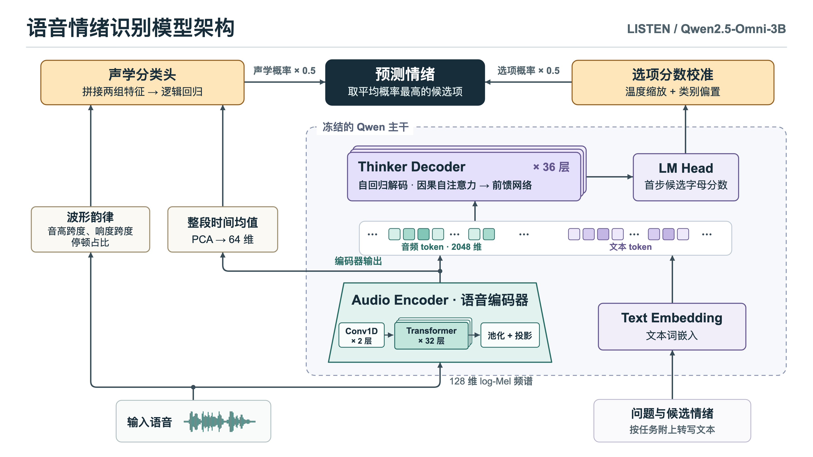

# LISTEN Emotion Readout

一句话的词义可以很平常，说话人的语气却可能透露出愤怒或兴奋。这个项目研究一个问题：冻结语音大模型后，直接利用它的音频编码器，能否比让模型回答选择题更准确地识别情绪？

我们在 LISTEN 上测试了 Qwen2.5-Omni。用一个轻量分类器读取编码器特征，再结合模型自己的选项分数，**3B 的七项平均准确率从 25.43% 升至 49.86%，7B 从 31.43% 升至 53.45%**。基线与融合方法均由本项目在同一批留出样本上测得。

## 模型架构



- **模型怎样作答？** 音频送入冻结的 Audio Encoder。Thinker 解码器结合问题和候选情绪，为每个选项字母打分。我们用开发集学习温度和类别偏置，将分数转换为校准后的概率。
- **音频本身提供什么线索？** 对编码器的帧向量取平均，再用训练折拟合的 PCA 压至 64 维。另从波形提取三项韵律特征：音高起伏（有声帧音高的第 90 与第 10 百分位之差，单位为半音）、音量起伏（活跃帧能量的同一百分位差，单位为 dB）、句内停顿比例（首尾活跃帧之间的低能量帧占比）。
- **怎样选出情绪？** 将编码器向量与三项韵律特征拼接，训练逻辑回归分类器。在本题候选情绪内，将分类器概率与校准后的模型概率加权平均，取最高分。两种模型在开发集上选出的声学权重都是 0.5。

## 数据与实测结果

LISTEN 以英文多选题评测语音情绪。下表中“文”指给模型的**转写文本**，即把录音里说的原话写成文字。每题有自己的候选情绪。七个条件覆盖 3,737 道题、1,895 个录音组：其中 3,550 题来自原生测试集，187 道非词汇发声题从原训练集按录音组留出。属于留出录音组的样本全部从开发集剔除。总分是七列准确率的算术平均，每列权重相同。

| 模型与方法 | 中性词义·音 | 中性词义·音+文 | 词义语气一致·音 | 一致·音+文 | 词义语气冲突·音 | 冲突·音+文 | 非词汇发声·音 | 总分 (%) |
| --- | ---: | ---: | ---: | ---: | ---: | ---: | ---: | ---: |
| 3B · 原模型 | 25.52 | 19.93 | 36.08 | 38.05 | 21.90 | 16.19 | 20.32 | **25.43** |
| 3B · 融合 | 74.13 | 71.33 | 44.33 | 44.33 | 31.43 | 34.29 | 49.20 | **49.86** |
| 7B · 原模型 | 33.57 | 21.33 | 37.19 | 38.18 | 31.43 | 30.48 | 27.81 | **31.43** |
| 7B · 融合 | 77.27 | 74.48 | 44.33 | 45.81 | 37.14 | 40.00 | 55.08 | **53.45** |

在原生测试集的六个语音条件上，3B 的平均准确率由 26.28% 升至 49.97%，7B 由 32.03% 升至 53.17%。完整的分条件准确率、宏 F1、类别平均召回率和按录音组重采样的置信区间见 [3B 结果](benchmarks/3b.json) 与 [7B 结果](benchmarks/7b.json)。

### 消融实验

| 方法 | 3B 准确率 (%) | 7B 准确率 (%) |
| --- | ---: | ---: |
| 原模型生成答案 | 25.43 | 31.43 |
| 只校准模型的选项分数 | 30.28 | 33.96 |
| 声学分类器 · 只用三项韵律 | 17.45 | 17.45 |
| 声学分类器 · 韵律 + 编码器 | 47.83 | 51.50 |
| 完整方法 · 声学分类器 + 校准分数 | **49.86** | **53.45** |

加入编码器向量给声学分类器带来的提升最大。随后融合语言模型的校准分数，3B 再提升 2.03 个百分点，7B 再提升 1.95 个百分点。

## 复现一个模型

在 Linux 上使用 Python 3.11、Bash 和一张支持 BF16 的 NVIDIA 显卡。原实验使用单张 RTX 6000D，PyTorch 2.7.0+cu128、Transformers 4.57.3、SDPA，逐条贪心解码。下面以 3B 为例，所有命令在仓库根目录执行。

```bash
python3.11 -m venv .venv
source .venv/bin/activate
pip install torch==2.7.0 torchvision==0.22.0 --index-url https://download.pytorch.org/whl/cu128
pip install -r requirements.txt
python scripts/smoke.py
```

下载固定版本的四个数据分片并核验 SHA-256，准备清单、16 kHz 单声道音频和韵律特征。权重通过 Hugging Face 下载到本地。

```bash
python scripts/download_data.py data/parquet scripts/shards.json
python scripts/prepare_listen.py data
python scripts/prosody.py data --workers 6
hf download Qwen/Qwen2.5-Omni-3B --local-dir models/Qwen2.5-Omni-3B
CUDA_VISIBLE_DEVICES=0 bash scripts/run_model.sh 3B
```

结果写入 `runs/3B/`。在 `methods/metrics.json` 中查看 `mixed_seven.unweighted_condition_means` 下的 `base.wa` 与 `fused.wa`，并与独立评分文件 `frozen_baseline.json` 对照。确认提升后，可以下载 7B 权重，并将脚本参数改为 `7B`。原实验先验证 7B，再评测 3B。[原实验协议](docs/protocol.txt)

### 用自己的录音演示

训练脚本会保存一个分类头。将下面的 `clip.wav` 换成自己的录音，即可查看同一段语音的基线与融合预测。默认提供七个候选情绪，可用 `--labels` 指定候选项。

```bash
python scripts/predict_clip.py --model models/Qwen2.5-Omni-3B \
  --bundle runs/3B/methods/fitted_heads.joblib --wav clip.wav
```

## 局限

分类头使用了 LISTEN 的训练标签，表中增益反映的是有监督适配。主实验按录音分组，同一位说话人仍可能出现在训练和测试中。当前结果覆盖英文、给定候选项的情绪识别。中文、开放词表和跨数据集表现仍需单独测量。

## 来源与贡献

LISTEN 评测、数据和 Qwen 模型应分别引用其作者。[LISTEN 论文](https://aclanthology.org/2026.eacl-long.274/) · [评测参考实现](https://github.com/DeliJingyiC/LISTEN/tree/32966584488bd3b3c67a150bd55f1f18ca09ef76) · [数据集固定版本](https://huggingface.co/datasets/VibeCheck1/LISTEN_full/tree/f6397b5bfedd85ae41b80dac13e95bb55adf0a35) · [Qwen 3B](https://huggingface.co/Qwen/Qwen2.5-Omni-3B) · [Qwen 7B](https://huggingface.co/Qwen/Qwen2.5-Omni-7B)

本项目的原创代码和文档采用 [MIT 许可证](LICENSE)。数据和预训练权重从原发布方获取，使用时遵循各自条款。欢迎通过 Issue 分享复现结果，或通过 Pull Request 提交改进。[贡献指南](CONTRIBUTING.md)
